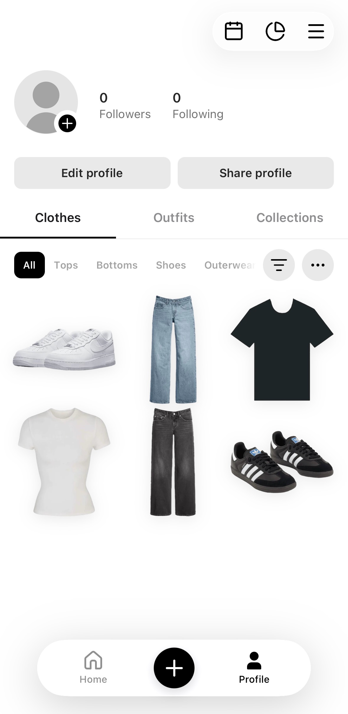
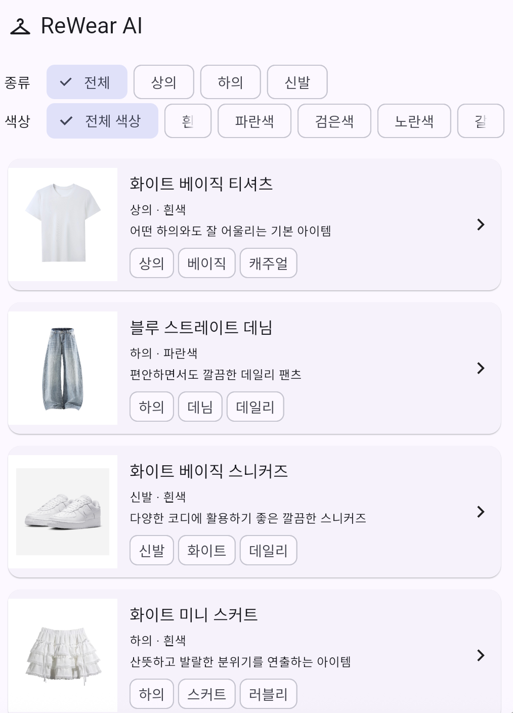
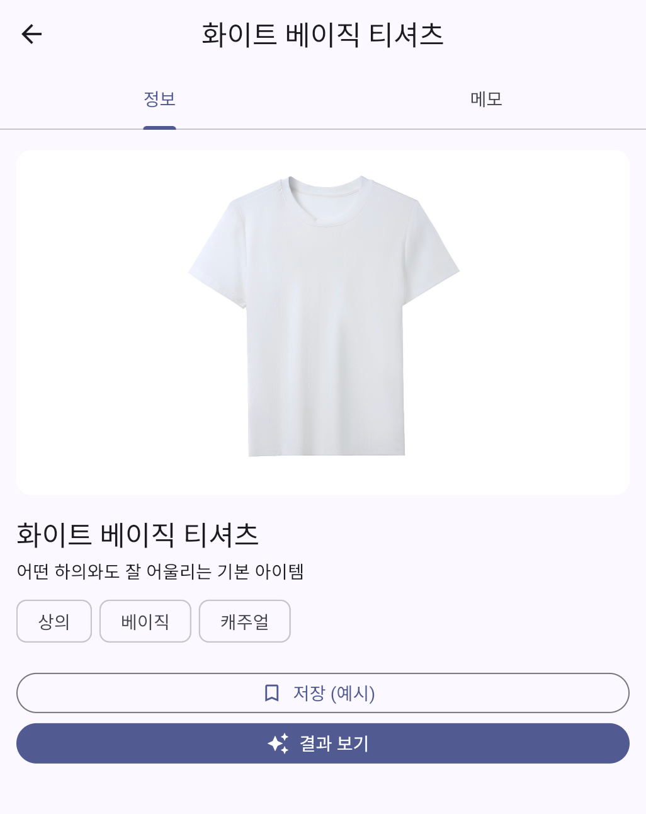
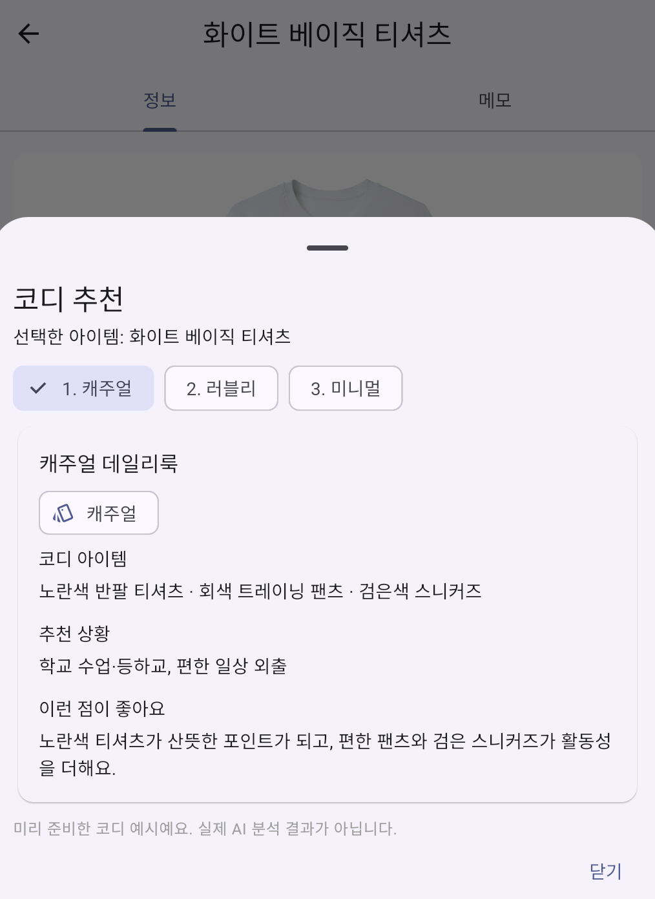
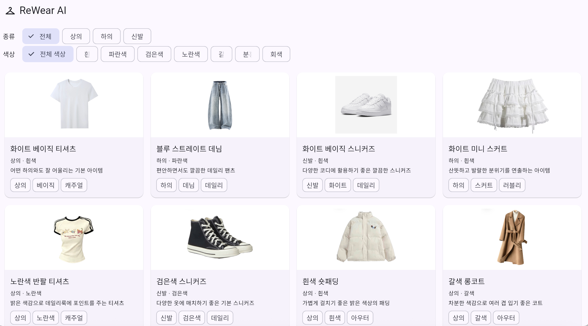

# ReWear AI v2 — GAI3008 중간프로젝트

## 앱 소개

### 앱 이름
ReWear AI v2

### 부제
이미 가지고 있는 옷으로 새로운 코디를 찾아주는 옷장 앱

### 카테고리
라이프스타일 (Lifestyle)

### 대상 사용자 / 사용 상황
- 대상 사용자: 코디에 고민이 많은 대학생
- 사용 상황: 외출 전 스마트폰이나 웹 화면에서 옷장에 있는 옷을 확인하고 새로운 코디를 탐색하는 상황

### 스크린샷
이미지는 `docs/screenshots/`에 넣고 아래 파일 이름을 맞춥니다.

| v1 현행 | v2 화면 A | v2 화면 B | v2 화면 C | v2 넓은 화면 |
|---|---|---|---|---|
|  |  |  |  |  |
| 기존 앱 화면 | 옷장 목록 | 옷 상세 | 코디 결과 | 넓은 화면 레이아웃 |

### 설명
1. ReWear AI는 사용자가 가진 옷을 바탕으로 코디를 탐색할 수 있도록 돕는 옷장 앱이다.
2. v2는 옷을 확인하고 상세 정보를 살펴본 뒤 코디 결과를 확인하는 화면 흐름을 제공한다.
3. 핵심 가치는 기존 옷을 다시 활용해 코디를 고민하는 부담을 줄이는 것이다.

### 새로운 기능
| P번호 | 바뀐 것 (화면 · 요소 번호) | 근거 (리뷰 · 원칙) |
|---|---|---|
| P03 | 화면 B에서 상세 정보를 확인하고 화면을 이동할 수 있도록 구성 | 사용자가 현재 흐름을 파악하고 이동할 수 있도록 고려 |
| P06 | 화면 A에서 옷의 이미지를 통해 항목을 알아보기 쉽게 구성 | 텍스트를 기억하는 대신 시각적으로 항목을 인식하도록 고려 |
| P07 | 화면 A의 옷장 목록을 통해 여러 옷 항목을 확인할 수 있도록 구성 | 목록 탐색의 효율성을 고려 |

### 평가 및 리뷰

| 항목 | 내용 |
|---|---|
| 현행 별점 | 4.6 / 5.0 (미국 App Store 기준, 게시 전 재확인 필요) |
| 리뷰 수 | 5.6K Ratings (미국 App Store 기준, 게시 전 재확인 필요) |
| 대표 리뷰 1 | “Their AI outfit planner is completely useless. Nothing goes together in their outfit ideas!” |
| 대표 리뷰 2 | “Reordering items takes forever because you have to drag each piece individually through your entire wardrobe, and you can’t organize within categories.” |
| 대표 리뷰 3 | “The choice of colors to categorize under is lacking, even with the pro options.” / “There’s no filtering system once you’re putting an outfit together.” |
| 주요 개선점 | AI 코디 추천 품질 향상, 카테고리별 의류 정리 기능 개선, 색상 분류 및 코디 필터링 기능 강화 |
| 출처 | [Fits – Outfit Planner & Closet (App Store)](https://apps.apple.com/us/app/fits-outfit-planner-closet/id6447482321) |


## 작성자 · 제출 정보

| 칸 | 내용 |
|---|---|
| 현행 앱 | Fits – Outfit Planner & Closet |
| v2 한 문장 | ReWear AI v2는 코디에 고민이 많은 대학생이 기존 옷으로 새로운 코디를 찾도록 돕는다. |
| 작성자 | TONG XU · 1인 1팀 |
| 데모 | 웹 배포 URL: https://rewear-sage.vercel.app |
| AI 사용 | 규칙 `AGENTS.md` · 기록 `docs/prompt-log.md` · 셀프 논증 기록 `docs/셀프논증.md` |

> 이 프로젝트는 UI 프로토타입이다. 화면에서 제공하는 상호작용과 실제 데이터 저장·로그인·결제 기능은 구분해서 확인해야 한다.

## 실행 방법

준비물: Flutter SDK, Node.js 18 이상.

### 터미널 1 — 목업 서버

```bash
cd mock_server
npm install
npm start
```

### 터미널 2 — Flutter 앱

저장소 루트에서 실행한다.

```bash
flutter pub get
flutter run -d chrome
```

### 웹 배포 빌드

```bash
flutter build web --dart-define=API_BASE=https://rewear-api.vercel.app/api
```

## 상태 화면 시연

```bash
flutter run --dart-define=DEMO_STATE=loading
flutter run --dart-define=DEMO_STATE=error
flutter run --dart-define=DEMO_STATE=empty
```

## 프로젝트 구조

- `lib/`: Flutter 화면, 모델, API 및 공통 위젯
- `mock_server/db.json`: 목업 데이터
- `mock_server/`: 목업 서버
- `docs/`: 디자인 가이드, 원칙 카드, prompt-log, 셀프 논증 기록, 자가평가 및 스크린샷
